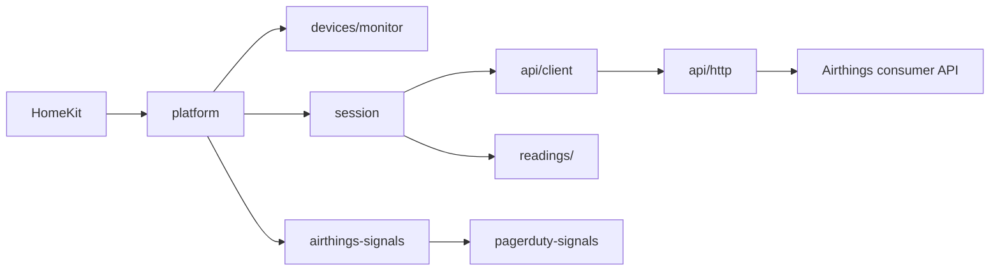

# Development

HomeKit talks to the platform. The platform owns accessory identity. A session polls. The client talks to Airthings. Readings are pure: no timers and no HomeKit.



## Architecture

```text
src/
  index.ts                 Entry point. Registers the MyAirthings platform.
  settings.ts              Constants and readPluginVersion().
  platform.ts              Accessory lifecycle, discovery, removal, and the poll loop.
  session.ts               One poll: device list, samples, and the wait until the next one.
  airthings-signals.ts     Which of the three PagerDuty signals is active.
  pagerduty-signals.ts     Signal-store writer, copied from homebridge-pagerduty. Do not edit it.
  types/                   Config, cloud view, and reading types.
  api/
    client.ts              Token, accounts, devices, samples. Injectable transport.
    http.ts                HTTPS JSON. No redirects. Connect and total deadlines. Body cap.
    parse.ts               Token, account, device, and sensor payloads.
    urls.ts                Consumer paths. Account ids are checked before they go in a URL.
    rate-limit.ts          X-RateLimit-Remaining, X-RateLimit-Reset, Retry-After.
  readings/
    plan.ts                Services from the device sensors array.
    quality.ts             The Good / Fair / Poor word.
    units.ts               Metric conversion, including VOC ppb to µg/m³.
    sample.ts              One sample, plus whether it is still fresh.
  devices/
    monitor.ts             One accessory. Publishes characteristics. Never waits on the network.
    layout.ts              Which services exist, and which one is primary.
    eve.ts                 Eve and plugin-owned characteristics, added by display name.
    base-accessory.ts      Accessory Information.
    host.ts                The narrow surface a device handler may use. Types only.
  diagnostics/
    collector.ts           Opt-in poll counters and latency percentiles.
    format.ts              The health line.
  utils/
    validators.ts          Startup config. A bad value warns or refuses to start.
    context.ts             What is remembered on a cached accessory.
    names.ts               HomeKit name length, and VIEW_PLUS to View Plus.
    redact.ts              Redaction by shape, and forLog.
    errors.ts              Typed errors and a log-safe description.
    startup-report.ts      The lines written once a device list has been applied.
scripts/
  smoke.js                 One read-only poll against a real account, through dist/.
  lib/common.js            Client from the environment or a hidden prompt. Never argv.
config.schema.json         Homebridge UI settings. pluginAlias is MyAirthings.
docs/
  README-DETAILED.md       Every setting, service, log line, and troubleshooting step.
  FEATURES.md              Feature checklist.
  API.md                   The consumer API this plugin calls.
```

Airthings facts live in [docs/API.md](docs/API.md).

`dist/` is committed so a git install works. CI fails if it drifts from `src/`. Run `npm run build` and commit `dist/` with every source change. Do not add a `prepare` script: it dirties the tree on every `npm install`. `prepublishOnly` rebuilds before a publish.

## Design principles

- **No runtime dependencies.** HTTPS comes from Node. `homebridge` is a devDependency used for types. At runtime, HAP comes from the injected `api.hap`.
- **Dev-dependency hygiene.** `overrides` hold transitive dev packages off known advisories: `js-yaml` at `^4.3.2`, `brace-expansion` at `^5.0.12`, `handlebars` at `^4.7.10`, and `deepmerge` at `4.1.2`. GHSA-gcqx-w48m-w2h4 affects `deepmerge` 4.2.0 through 4.3.1. `4.1.2` is the last release outside that range. Jest's config loader is the only user. It is not shipped. Raise that pin when a release outside the range exists. The other three use a floating minimum so a later fix is picked up.
- **Strict TypeScript**, plus `noUncheckedIndexedAccess` and `noImplicitOverride`. `npm run lint` uses `--max-warnings 0`.
- **Readings are pure.** `src/readings/` does not import Homebridge, start a timer, or open a socket.
- **Fail fast on bad config, and leave cached accessories registered.** Unregistering them makes HomeKit discard rooms and automations the user cannot get back by fixing a typo. Those accessories answer No Response until the config works.
- **The network client is injectable.** Tests pass a stand-in for `requestJson`. Nothing in the suite dials Airthings.
- **`src/pagerduty-signals.ts` is frozen.** Other plugins and homebridge-pagerduty agree on that text. Replace the file only by copying a newer module from `docs/SIGNALS-AGENT.md` in homebridge-pagerduty.

## Invariants

- **The Homebridge platform name is `MyAirthings`.** Airthings is the product, and the manufacturer string on the accessory. `platform` in `config.json` and `pluginAlias` in `config.schema.json` are `MyAirthings`. Homebridge already has a platform named Airthings. This plugin does not use that name.
- **Identity is the serial number, in lowercase.** A renamed monitor keeps its room and automations. HomeKit stores `uuid.generate` of `homebridge-myairthings:` plus that serial. The stored id is a UUID, not the seed string.
- **Bad config disables the platform. It does not unregister anything.**
- **A failed poll does not remove a monitor.** Removal happens only after a device list that succeeded and omitted that serial.
- **The client secret never reaches a log.** Not its value, its length, or a prefix. `src/utils/redact.ts` redacts by shape.
- **When a monitor reports radon, the tile is radon.** CO₂, particles, VOC, and humidity do not change the word.
- **A rejected client and an unreachable account are separate pages.** Either one turns the per-monitor stale signals off. A rate limit does not write a row.
- **An outage does not speed up the poll.** Connection failures, unreadable payloads, and HTTP 5xx count as one unreachable poll. The next attempt is still the normal interval. Three in a row mark the sensors inactive. A fault inside the plugin also waits the normal interval. The 120 requests an hour are shared by every call, so a retry loop would spend them.

## Commands

Node 22.13 or later, 24, or 26, matching `engines`. 22.13 is the first 22.x where `node:sqlite` loads without a flag, so CI runs it by exact version alongside 22, 24 and 26.

```bash
npm install
npm run build                          # commit dist/ with the source
npm run lint                           # warnings are failures
npx tsc --noEmit -p tsconfig.test.json # src + tests
npm test                               # jest with coverage (NODE_ENV=test)
```

`npm install` does not build. There is no `prepare` script. Run `npm run build` and commit the result. `prepublishOnly` cleans and rebuilds before a publish.

The suite never calls Airthings. `tests/setup.js` refuses to run if `AIRTHINGS_CLIENT_ID` or `AIRTHINGS_CLIENT_SECRET` is set. Test credentials are built at runtime in `tests/helpers/secrets.ts`.

Coverage is gated at 90% for statements, functions and lines, and 75% for branches. `jest.config.js` lists the files that are excluded.

## Run it in Homebridge

Unit tests never open a socket to Airthings. To check a build against an account without Homebridge, run one read-only poll:

```bash
npm run build
node scripts/smoke.js
```

It prints each monitor's sensors, converted readings, and tile word. [scripts/README.md](scripts/README.md) explains the output.

To try the build in Homebridge, install this checkout and restart Homebridge with debug logging.

```bash
npm run build
npm install -g .
homebridge -D
```

`npm install -g .` updates the npm prefix of the shell you run it in. If Homebridge was installed with a different npm, run the install with that one, then restart Homebridge.

Enter the client id and client secret in the plugin settings. The platform name is MyAirthings. The `debug` setting prints radon, CO₂, temperature, and sample age after every poll, as debug lines that Homebridge shows only in debug mode. It does not print the secret.

## Adding a setting

1. Add it to `AirthingsPlatformConfig` and `ResolvedConfig` in `src/types/`, and validate it in `src/utils/validators.ts`. A missing optional value uses the default. A value of the wrong type warns and uses the default, unless the plugin cannot run without it.
2. Add it to `config.schema.json`, including the `layout` array. The settings screen shows only the fields the layout lists. `tests/unit/verified-plugin.test.ts` checks the bounds and that `pagerdutySignals` is in the layout. `required` must be an array of property names.
3. Document it in [docs/README-DETAILED.md](docs/README-DETAILED.md#full-configuration-reference).
4. `npm run build` and commit `dist/`.

## Adding a reading

Do not edit `src/pagerduty-signals.ts`.

1. Read [docs/API.md](docs/API.md) for the sensor name and the unit Airthings sends.
2. Recognize the name in `src/readings/plan.ts`, and convert the unit in `src/readings/units.ts`.
3. If the reading changes the Good / Fair / Poor word, change `src/readings/quality.ts` and say so in the docs. A monitor that reports radon keeps radon as the word.
4. Add the service or characteristic in `src/devices/layout.ts` and `src/devices/monitor.ts`. A characteristic HomeKit does not ship is added in `src/devices/eve.ts` with `new hap.Characteristic(displayName, uuid, props)`, and published by that display name.
5. Add unit tests for the conversion, the plan, and the published characteristic.
6. Update [docs/API.md](docs/API.md), [docs/FEATURES.md](docs/FEATURES.md), and [docs/README-DETAILED.md](docs/README-DETAILED.md#services).
7. `npm run build` and commit `dist/`.
